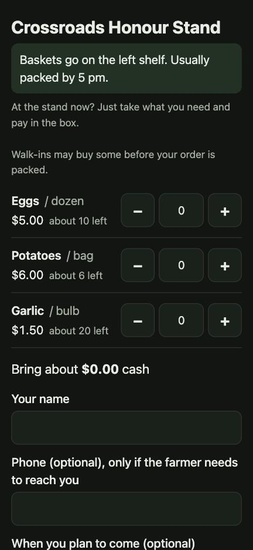
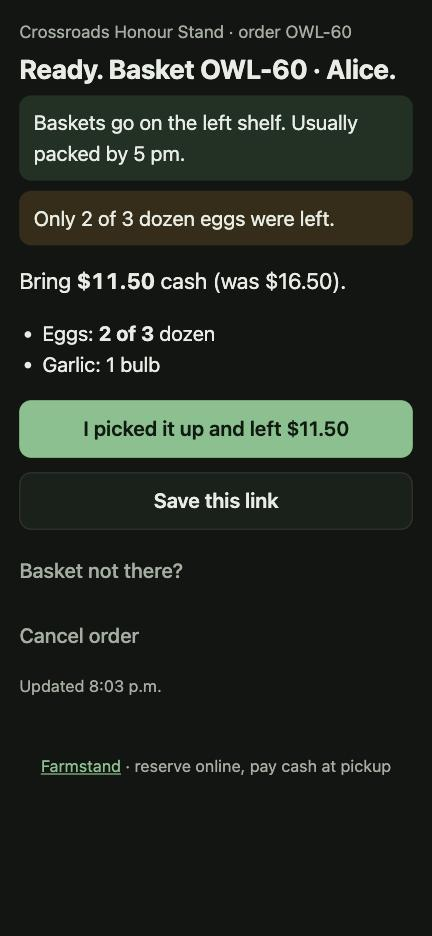
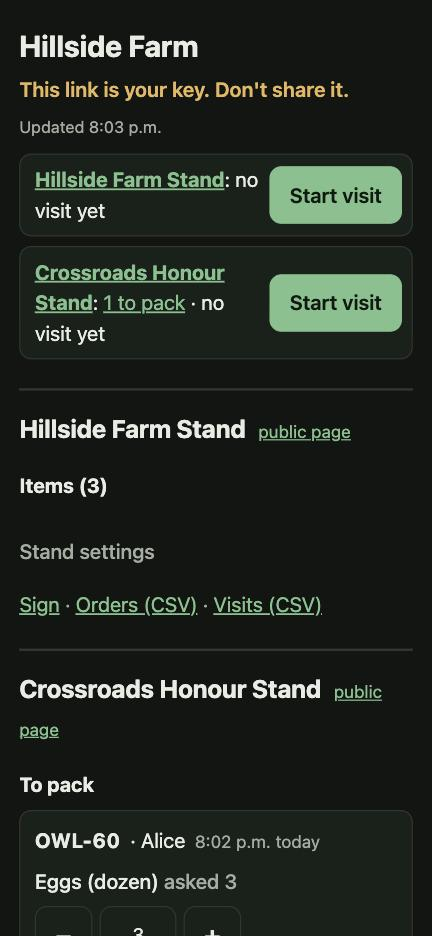
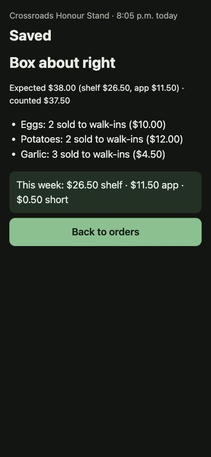
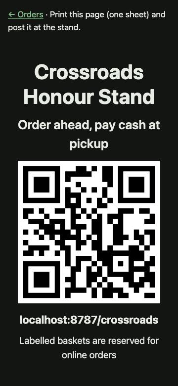

# Farmstand

Reserve farmstand items online, pay cash at pickup.

A customer scans the QR code on a stand's sign, picks what's there, and sees how much cash to
bring. The farmer packs a labelled basket. Nobody pays ahead, so a reservation is a soft hold
the farmer can release. For honour-box stands, a two-minute **visit** works out walk-in sales
from a quick count, so the farmer can check the whole cash box, not just the app orders.

No customer accounts. No card payments. No app to install. MIT licensed.

| Stand page | Order page | Seller page | Visit summary | Sign |
|---|---|---|---|---|
|  |  |  |  |  |

## How it works

```
customer reserves ──► placed (held) ──farmer packs──► ready ──picked up──► done
                          │                             │
                          └── farmer releases / customer cancels ──► back on sale
```

- **Holds:** a reservation takes items off the free count at once. Two people can't both get
  the last dozen: every order is one database transaction, and a `CHECK (held <= stock)`
  constraint refuses to sell a unit twice.
- **Cash:** totals round to the nearest 5¢ (Canada's cash rule; set `CASH_ROUND_CENTS`).
- **Packing short:** if walk-ins took some, the farmer packs fewer and the customer's page
  shows "Bring $10.00 (was $15.00)".
- **The visit:** unpack cancelled baskets, tick baskets that are gone, pack waiting orders,
  count the shelf, count the box. Walk-in sales = stock − what's present (+ anything packed
  short). Expected cash = walk-in sales + app orders picked up since the box was last
  emptied. A blank count means "not counted", never zero. The visit keeps a draft on the
  phone and can be retried safely after losing signal.
- **Live pages, no messages:** order and seller pages refresh every 30 seconds while they're
  open and something changed. Nothing is sent by email or text.

## Privacy

Customers give a name and, optionally, a phone number. A daily job removes names, phone
numbers and notes from closed orders older than 30 days; totals stay for the farmer's records.
Farmers can export their orders and visits as CSV.

## Run your own

[](https://deploy.workers.cloudflare.com/?url=https://github.com/dfakkeldy/farmstand)

The button copies this repo to your GitHub account, creates the D1 database and deploys the
Worker on your Cloudflare account. Small stands fit easily in Cloudflare's free tier.

Or by hand:

```bash
npm install
npx wrangler d1 migrations apply farmstand --remote
npx wrangler deploy
```

Then set up a farmer, a stand and a login link (`--remote` works on the deployed database):

```bash
export FARMSTAND_URL=https://your-worker.example.workers.dev
npm run admin -- seller add "Hillside Farm" --remote
npm run admin -- stand add --seller 1 --slug hillside --name "Hillside Farm Stand" --mode unattended --remote
npm run admin -- link add --seller 1 --label "Mary's phone" --remote
```

The link is shown once. Send it privately; it is the farmer's key. Other commands:
`list`, `link revoke ID`, `stand off SLUG`, `stand on SLUG`.

Settings in `wrangler.jsonc`: `CASH_ROUND_CENTS` (default `5`), `TIMEZONE` (default
`America/Halifax`), `TURNSTILE_SITE_KEY` (optional bot check; also set the
`TURNSTILE_SECRET` secret and turn it on for a stand).

## Develop

```bash
npm install
npm run db:migrate:local
npm run seed:local                              # two demo stands, no login link
npm run admin -- link add --seller 1            # prints a local seller link
npm run dev                                     # http://localhost:8787/crossroads
npm test                                        # Vitest in the Workers runtime with a real local D1
npm run typecheck
```

Design notes: [`docs/superpowers/specs/2026-11-07-farmstand-design.md`](docs/superpowers/specs/2026-11-07-farmstand-design.md).

## Licence

MIT. See [LICENSE](LICENSE).
